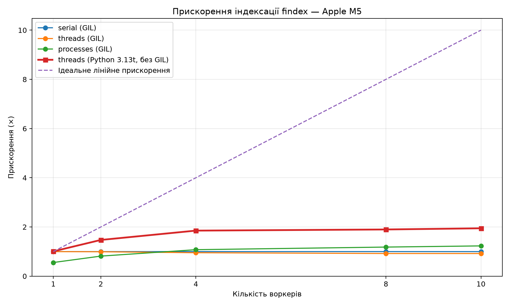

# findex — лабораторні роботи №1–5

[](https://github.com/Artem0311/python-university-labs/actions/workflows/ci.yml)

`findex` — навчальна пошукова система для локальних текстових документів. Проєкт послідовно розвивається в межах п'яти лабораторних робіт: від потокового читання корпусу до інвертованого індексу, ранжування, командного рядка та паралельної індексації.

**Поточна версія пакета:** `0.4.0` (версія лабораторної №4; тег лабораторної №5 — `lab-05`).  
**Курс:** Програмування на Python

---

## Лабораторна робота №1 — Ітератори, генератори та текстовий корпус

**Тема:** Ітератори, генератори та текстовий корпус  
**Курс:** Програмування на Python  
**Мета:** створити початкову частину пошукової системи `findex`: читати текстові документи по одному, потоково розбивати їх на токени, підраховувати статистику й порівнювати використання пам'яті генераторами та списками.

### Структура проєкту на етапі №1

```text
findex/
├── data/                    # Локальний корпус, не додається до Git
│   ├── test.txt
│   └── wiki/                # Статті та sources.tsv після завантаження
├── src/findex/
│   ├── __init__.py
│   ├── corpus.py            # M1: iter_documents()
│   ├── tokenize.py          # M2: tokenize()
│   ├── stats.py             # M3: статистика корпусу
│   └── benchmark.py         # M4: eager та lazy
├── tests/
│   ├── test_corpus.py
│   └── test_tokenize.py
├── fetch_corpus.py          # Завантаження текстів з Вікіпедії
├── pyproject.toml
└── uv.lock
```

### Корпус текстів

Обрано україномовні статті Вікіпедії, пов'язані з програмуванням, алгоритмами та інформаційними технологіями. Джерело: [Українська Вікіпедія](https://uk.wikipedia.org/) (умови використання матеріалів — [CC BY-SA](https://creativecommons.org/licenses/by-sa/4.0/)).

На момент вимірювання корпус складався з **14 документів**: **13 статей Вікіпедії** та **1 навчального документа** `test.txt`. Перелік завантажених статей із посиланнями записується у `data/wiki/sources.tsv`.

Корпус знаходиться в `data/`, яку додано до `.gitignore`, тому текстові файли не потрапляють до репозиторію. Щоб отримати власний набір текстів, із кореня проєкту виконайте:

```bash
uv run python fetch_corpus.py
```

Для роботи програм достатньо будь-яких власних текстових файлів `.txt` у `data/` та її підкаталогах. Кількість отриманих статей із Вікіпедії може відрізнятися залежно від доступності текстів через API.

### Реалізація

- **M1 — `iter_documents(root)`**: генератор на основі `pathlib`, що знаходить `.txt` у дереві каталогів, відкриває та повертає документи по одному. Файли з помилками декодування UTF-8 пропускаються з повідомленням у журналі.
- **M2 — `tokenize(text)`**: генератор, який нормалізує Unicode й послідовно віддає токени через `re.finditer`.
- **M3 — `stats.py`**: за один прохід рахує кількість документів і токенів, обсяг словника та 50 найчастіших термінів, а також час (`time.perf_counter`) і пікову пам'ять (`tracemalloc`). Ключ `--limit N` використовує `itertools.islice`.
- **M4 — `benchmark.py`**: порівнює потокову версію (`lazy`) з навмисно жадібною (`eager`), яка накопичує документи та списки токенів у пам'яті.

#### Правила токенізації

1. Перед пошуком слів виконується `unicodedata.normalize("NFC", text)` і `str.casefold()` — для однакового запису символів та незалежності від регістру.
2. **Апострофи:** внутрішній апостроф зберігається: `п'ять`, `комп'ютер`. Символи `’` та `ʼ` приводяться до `'`.
3. **Дефіси і тире:** вважаються роздільниками: `веб-застосунок` → `веб`, `застосунок`.
4. **Цифри:** зберігаються в токенах: `2026` → `2026`, `Python3` → `python3`.
5. Розділові знаки та підкреслення розділяють токени. Функція повертає токени один за одним, а не списком.

Тести містять перевірки регістру, кирилиці, комбінованих діакритичних знаків, пунктуації та порожнього рядка.

### Запуск і перевірка

Усі команди виконуються з кореневої папки `findex/`:

```bash
uv sync
uv run pytest
uv run ruff check .
uv run python -m findex.stats data/
uv run python -m findex.stats data/ --limit 10
uv run python -m findex.benchmark data/
```

### Результати вимірювань

Вимірювання виконано на локальному корпусі з **14 документів**. Пікова пам'ять — значення `tracemalloc` для виділень пам'яті Python; це не повний обсяг оперативної пам'яті процесу.

| Версія | Документів | Пікова пам'ять | Час виконання |
|---|---:|---:|---:|
| eager (списки) | 14 | 1.243 MiB | 0.0218 с |
| lazy (генератори) | 14 | 0.590 MiB | 0.0262 с |

**Пояснення.** Жадібна версія спочатку формує список усіх об'єктів документів, а потім окремі списки токенів для кожного документа. Ці структури одночасно займають пам'ять разом із таблицею частот. Потокова версія обробляє документи та токени послідовно: попередні документи й проміжні списки не накопичуються, а в пам'яті залишаються поточний документ, лічильник частот та службові структури Python. Саме тому пік пам'яті у варіанті `lazy` менший.

За цим одиничним вимірюванням `eager` був трохи швидшим; швидкість може коливатися між запусками.

**Статистика корпусу (`stats.py`):** 14 документів; 10 769 токенів; 4 027 унікальних термінів. Час: **0.0229 с**; пікова пам'ять: **0.639 MiB**. Повний топ-50 термінів виводиться командою `uv run python -m findex.stats data/`.

### Висновок

Генератори дозволяють обробляти текстовий корпус послідовно, без зберігання всіх документів і списків токенів. На тестовому корпусі потокова версія використала менше пам'яті, ніж версія на списках, за однакового результату підрахунку.

---

## Лабораторна робота №2 — Інвертований індекс: словники, хешування та пам'ять

**Мета:** на базі потокового конвеєра лабораторної №1 побудувати інвертований індекс, реалізувати булевий пошук, збереження/завантаження та порівняти продуктивність різних структур даних.

### Реалізація

До попереднього проєкту додано три модулі:

- `src/findex/index.py` — формує індекс за один прохід по генератору документів. Для кожного документа використовується `Counter`, для списків постингів — `defaultdict(list)`. Записи `Posting(doc_id, tf)` упорядковані за зростанням `doc_id`; окремо зберігаються довжини документів `doc_lengths` і назви/шляхи `doc_meta`. `Posting` та `DocMeta` визначено як `@dataclass(frozen=True, slots=True)`: вони незмінні й хешовані.
- `src/findex/search.py` — пошук за двовказівниковим злиттям відсортованих списків (`merge`) або операціями над множинами (`set`). Підтримуються неявне `AND` між словами та оператори `AND`, `OR`, `NOT`. Запити обчислюються зліва направо без дужок.
- `src/findex/store.py` — збереження та завантаження індексу у форматі Pickle (`.bin`) і JSON (`.json`).

Позиції токенів не зберігалися: ця функція була необов'язковою для лабораторної №2 та додана у №3.

### Команди запуску

Запуск із каталогу `findex/` після `uv sync`:

```bash
python -m findex.index data/ --out index.bin
python -m findex.search index.bin "у AND і"
python -m findex.search index.bin "у AND NOT і" --engine set
```

Команда індексування друкує кількість документів, кількість термінів, час роботи й пікові виділення пам'яті. Команда пошуку показує знайдені документи та їхні назви, пошуковий рушій, час і пік пам'яті. Розширення `.json` вибирає JSON, інші розширення — Pickle.

**Безпека:** `pickle.load()` не можна застосовувати до недовірених або завантажених із невідомих джерел файлів: спеціально сформований Pickle може виконати довільний код під час десеріалізації. Індекс Pickle потрібно завантажувати лише зі створених власноруч файлів; для обміну даними можна використати JSON.

### Експериментальні дані

Вимірювання виконано на тому самому локальному корпусі: **14 документів, 10 769 токенів, 4 027 термінів, 5 643 постинги**. Часи є результатами конкретних локальних запусків на macOS; значення змінюються між вимірюваннями.

#### Порівняння пам'яті для постингів

| Представлення постингів | Пік пам'яті побудови (`tracemalloc`) | Розмір Pickle-файлу | Середній час завантаження Pickle |
|---|---:|---:|---:|
| Звичайний `@dataclass` | 963 440 байт (940,9 KiB) | 186 537 байт | 2,060 мс |
| `@dataclass(frozen=True, slots=True)` | 734 360 байт (717,1 KiB) | 163 954 байт | 3,788 мс |
| Дві послідовності `array('I')`: ID й частоти | 1 140 000 байт (1 113,3 KiB) | 254 175 байт | 1,852 мс |

**Куди пішли байти.** Звичайний клас `dataclass` має додаткові накладні витрати на словники атрибутів об'єктів, тому його постинги займають більше пам'яті. `slots=True` замінює такі словники фіксованими слотами та дав найменший пік у нашому вимірюванні — приблизно на **23,8 %** менше, ніж звичайний `dataclass`. Хоча `array('I')` зберігає цілі числа компактно, тут на **4 027 термінів** припадає лише **5 643 постинги**, а для кожного терміна створювалися **два окремі об'єкти масиву**.

Накладні витрати цих численних коротких масивів переважили економію на числах. Для великих списків результат може бути іншим.

**Умови порівняння.** Для побудови всі три представлення створювалися з однакового заздалегідь підготовленого списку `(term, doc_id, tf)`. `tracemalloc` запускався перед створенням кожного представлення; наведений пік відображає додаткові виділення пам'яті цього етапу, а не повний обсяг процесу. Розмір файлу та час завантаження виміряно для **словника постингів**, серіалізованого через `pickle.HIGHEST_PROTOCOL` (не для всього об'єкта індексу). Час завантаження — середнє за 100 повторень.

#### Boolean-пошук: `merge` проти `set`

Відібрано два найчастіші терміни за загальною частотою (`у`: 171; `і`: 159) та два найрідкісніші (`0177907`: 1; `02`: 1). Час — середнє за **3 000 запусків** одного запиту для кожного рушія.

| Терміни та операція | `merge` | `set` | Знайдено документів |
|---|---:|---:|---:|
| Часті: `у AND і` | 2,16 мкс | 2,07 мкс | 12 |
| Часті: `у OR і` | 2,24 мкс | 2,07 мкс | 13 |
| Рідкісні: `0177907 AND 02` | 1,51 мкс | 1,64 мкс | 0 |
| Рідкісні: `0177907 OR 02` | 1,59 мкс | 1,76 мкс | 2 |

Результати `merge` і `set` збіглися в усіх чотирьох випадках. У цьому вимірюванні `set` був трохи швидшим на частих термінах, `merge` — на рідкісних. Через малі часи виконання різниця чутлива до навантаження системи.

#### Збереження та завантаження повного індексу

| Формат | Розмір файлу | Час збереження | Час завантаження | Термінів після завантаження |
|---|---:|---:|---:|---:|
| Pickle (`index.bin`) | 165 728 байт | 3,77 мс | 3,74 мс | 4 027 |
| JSON (`index.json`) | 117 197 байт | 6,62 мс | 2,69 мс | 4 027 |

На цьому корпусі JSON виявився меншим за розміром, а Pickle — швидшим під час збереження. Результати не слід узагальнювати на всі набори даних.

#### Приклад наскрізного запуску

Побудова та збереження повного індексу через CLI: **14 документів**, **4 027 термінів**, **0,0427 с**, **2 366 900 байт** пікової пам'яті (`tracemalloc`). Пошук `у AND і` через `merge`: **12 документів**, **0,0557 с**, **2 203 505 байт**. Пошук `у AND NOT і` через `set`: **1 документ**, **0,0317 с**, **2 203 321 байт**.

### Висновок до лабораторної №2

Інвертований індекс дозволяє виконувати пошук без повторного читання текстів усього корпусу. Булеві запити працюють двома методами й дають однакові результати. `slots=True` зменшив витрати пам'яті для коротких постингів, а використання багатьох дрібних масивів `array('I')` на цьому корпусі виявилося дорожчим. Обидва формати серіалізації коректно зберегли та відновили індекс, а час і розмір було виміряно експериментально.

---
## Лабораторна робота №3 — Рейтинг і модель об’єктів: dunder-методи, протоколи, декоратори

**Мета:** розширити пошукову систему `findex` засобами об’єктної моделі Python, додати ранжування TF-IDF та BM25, рекурсивний розбір запитів, пошук фраз, вимірювання часу, кешування та підсвічені фрагменти знайдених документів.

Лабораторна №3 продовжує той самий проєкт і корпус лабораторних №1–2: **14 документів, 10 769 токенів, 4 027 унікальних термінів**. Функції попередніх робіт збережено.

### Реалізація

#### M1 — Об’єктна модель індексу

Клас `Index` наслідує `collections.abc.Mapping` і підтримує `len(index)`, `term in index`, `index[term]`, ітерацію та `repr(index)`. Статистика доступна через `num_docs`, `df(term)`, `doc_length(doc_id)` та `avg_doc_length`, для якого використано `functools.cached_property`.

Менеджер контексту `open_index(path)` реалізовано за допомогою `contextlib.contextmanager`: він відкриває індекс із JSON або Pickle та закриває файл, зокрема при винятку всередині блоку `with`. Збережено можливість читати індекси лабораторної №2 без позицій токенів. **Pickle завантажують лише з довірених файлів.**

#### M2 — Ранжування TF-IDF та BM25

У модулі `ranking.py` визначено протокол `Scorer` і дві взаємозамінні реалізації:

- `TfIdf` — логарифмічна частота слова (TF), обернена документна частота (IDF) та нормалізація за довжиною документа;
- `BM25(k1=1.5, b=0.75)` — насичення частоти слова й нормалізація за довжиною документа.

Функція `search()` підсумовує бали термінів лише для документів, які відповідають запиту, і відбирає топ-`k` через `heapq.nlargest`. Результати представлені `SearchResult` з `@dataclass(order=True)`.

**Три перевірки поведінки BM25.** Використано статистику наявного корпусу та контрольну частоту входжень для ізоляції впливу окремих параметрів формули.

| Перевірка | Отримано | Висновок |
|---|---|---|
| Рідкісний термін проти частого | `df=1`: **3.987191**; `df=14`: **0.058704** | Рідкісний термін отримує більший бал |
| Насичення частоти терміна | Приріст від 1 до 2 входжень: **0.457586**; від 19 до 20: **0.004061** | Двадцяте входження додає значно менше |
| Один термін у короткому та довгому документі | 47 токенів: **2.519997**; 2939 токенів: **0.641279** | Короткий документ отримує вищий бал |

Усі три контрольні перевірки пройшли. Це перевірки властивостей формули, а не твердження, що ці штучно задані частоти точно відповідають реальним входженням у вибраних документах.

#### M3 — Рекурсивний парсер запитів і позиції

Модуль `query.py` містить вузли `Term`, `Phrase`, `And`, `Or`, `Not`, метод `evaluate(index)`, а також операції `&`, `|`, `~` для побудови дерев програмним способом. Рекурсивний спуск підтримує `AND`, `OR`, `NOT`, дужки, неявне `AND` і точні фрази у подвійних лапках. Пріоритет: **NOT > AND > OR**.

Приклад дерева для запиту:

```text
python AND (async OR await) NOT java "event loop"
```

Тести порівнюють **структури дерев**, а не рядкові представлення. Пошук фраз використовує позиції токенів, що додаються до індексу за параметром `with_positions=True` (для командного рядка — прапорець `--positions`). Позиції зберігаються у JSON та Pickle. Старий `search_index()` з рушіями `merge` і `set` збережено окремо для лабораторної №2.

#### M4 — Декоратори, кеш і снипети

Модуль `timing.py` реалізує `@timed` через `functools.wraps` і `time.perf_counter`. Декоратор застосовано до `build_index()`, `load_index()` та `search()`.

Шлях **текст запиту → ID документів** кешується через `functools.lru_cache(maxsize=128)` окремо для кожного об’єкта `Index`; повторення запиту видно в журналі як `[cache] hit`, а перше виконання — як `[cache] miss`. Тимчасовий кеш не записується в Pickle.

Модуль `snippet.py` формує фрагмент навколо найкращого знайденого входження (вікно приблизно **±80 символів**) і виділяє знайдені терміни маркерами `**...**`. Для сніпетів використовується вихідний текст із каталогу корпусу.

### Файли, додані або оновлені у лабораторній №3

- `src/findex/index.py`, `store.py`, `search.py` — об’єктна модель, позиції, збереження, пошук та ранжування;
- `src/findex/ranking.py` — TF-IDF, BM25 і протокол `Scorer`;
- `src/findex/query.py` — парсер та дерево запиту;
- `src/findex/timing.py` — декоратор `@timed`;
- `src/findex/snippet.py` — фрагменти з підсвічуванням;
- `tests/test_query.py` — тести парсера та обчислення запитів.

### Запуск

З кореня проєкту `findex/`:

```bash
uv sync
uv run pytest -q
uv run ruff check .
```

Побудувати індекс **із позиціями слів** для фразового пошуку:

```bash
uv run python -m findex.index data/ --out data/index_lab03.json --positions
```

Приклад ранжованого пошуку з дужками, фразою та снипетами:

```python
from findex.ranking import BM25
from findex.search import search
from findex.store import open_index

query = '("програмне забезпечення" OR python) AND NOT java'
with open_index("data/index_lab03.json") as index:
    results = search(index, query, scorer=BM25(), k=5)
    for result in results:
        print(f"{result.score:.4f} | {result.title}")
        print(result.snippet)
```

`search()` використовує каталог `data/` для читання тексту снипетів за замовчуванням; його можна змінити аргументом `corpus_root`.

### Експериментальні результати

#### Три операції з `@timed`

Логи одного локального запуску на macOS (час у секундах):

```text
[timed] build_index: 0.011142 s
[timed] load_index: 0.007822 s
[timed] search: 0.000190 s
```

#### Перевірка кешування

Повторений запит `python OR java`:

```text
[cache] miss: 'python OR java'
[timed] search: 0.000129 s

[cache] hit: 'python OR java'
[timed] search: 0.000031 s

Cache hits: 1
Cache misses: 1
Pickle compatibility: OK
```

У цьому конкретному вимірюванні повторний пошук тривав приблизно у **4,16 раза менше**. Абсолютні значення часу змінюються між запусками.

#### Precision@5: TF-IDF проти BM25

Для 10 власних запитів сформовано **попередню ручну розмітку релевантності** за темами й доступними вступними фрагментами 14 документів. Розмітка не є повною експертною оцінкою всього тексту статей. Precision@5 обчислено як число релевантних документів у перших п’яти результатах, поділене на 5. Якщо видано менше п’яти документів, знаменник усе одно дорівнює 5.

| № | Запит | Релевантні ID | TF-IDF P@5 | BM25 P@5 |
|---:|---|---|---:|---:|
| 1 | `python` | 0 | 0.20 | 0.20 |
| 2 | `"мова програмування"` | 0, 4, 12 | 0.60 | 0.60 |
| 3 | `"програмне забезпечення"` | 3, 7, 10, 11 | 0.80 | 0.80 |
| 4 | `алгоритм` | 5, 6, 8, 9 | 0.80 | 0.80 |
| 5 | `статистичних OR статистиці` | 6, 12 | 0.40 | 0.40 |
| 6 | `"пошуку рядків"` | 8 | 0.20 | 0.20 |
| 7 | `"двочастковий граф"` | 9 | 0.20 | 0.20 |
| 8 | `"декларативне програмування"` | 13 | 0.20 | 0.20 |
| 9 | `"інформаційна технологія"` | 2 | 0.20 | 0.20 |
| 10 | `безплатне OR комерційне` | 10, 11 | 0.40 | 0.40 |
| **Середнє** | | | **0.400** | **0.400** |

В обох алгоритмів середній P@5 однаковий, проте порядок документів у видачі може відрізнятися. Наприклад, для `python` TF-IDF повернув ID `[0, 4, 12]`, а BM25 — `[0, 12, 4]`. На невеликому корпусі ці результати не слід узагальнювати на великі пошукові колекції.

### Перевірка сумісності

Останній виконаний запуск автоматичних тестів після підключення снипетів:

```text
18 passed in 0.02s
```

Додатковими перевірками підтверджено парсер зі складними дужками та фразами, ранжування, збереження позицій у JSON/Pickle, відкриття через `with`, журнал `@timed`, кеш-промах і кеш-влучання, а також підсвічені фрагменти документів. Фінальна перевірка перед створенням тега `lab-03` виконується окремо.

### Висновок до лабораторної №3

Індекс удосконалено відповідно до об’єктної моделі Python. Реалізовано взаємозамінні алгоритми TF-IDF і BM25, рекурсивний парсер логічних запитів, пошук точних фраз за позиціями, вимірювання часу, кешування та підсвічені снипети. На 10 запитах середній Precision@5 за попередньою розміткою становив **0.400** для обох алгоритмів. Функції попередніх лабораторних залишилися працездатними, а пошукову систему підготовлено до наступного розширення.

---

## Лабораторна робота №4 — Типи, тести, пакування і CLI

**Мета:** оформити наявний `findex` як встановлюваний Python-пакет із типізованим API, автоматичними тестами, інтерфейсом командного рядка та перевірками CI.

### Реалізація

- **Типізація:** анотації публічних функцій у `src/findex/`, `Scorer` на базі `typing.Protocol` для `TfIdf` та `BM25`, генератори з типами `Iterator` / `Generator`, `Literal["merge", "set"]` для вибору пошукового рушія. Pyright працює в режимі `strict`.
- **Тестування:** `pytest` із фікстурами з `tests/conftest.py`, `parametrize` (зокрема Unicode), тести індексації, парсера, операцій злиття, обох скорерів, збереження та завантаження JSON/Pickle, а також команд CLI через `typer.testing.CliRunner`.
- **Властивості Hypothesis:** результат `load_index(save_index(index))` еквівалентний початковому індексу; ID у постингах впорядковані й унікальні; алгоритми `merge` збігаються з перетином, об'єднанням і різницею множин `set`.
- **Пакування:** метадані, залежності та група `dev` описані у `pyproject.toml`; зафіксовано `uv.lock`; точка входу `findex = "findex.cli:app"`.
- **CLI та діагностика:** `Typer` і `Rich` для індикатора прогресу, таблиць результатів і статистики. Діагностика через `logging` у `stderr`: `-v` — рівень INFO, `-vv` — DEBUG. Очікувані помилки мають зрозуміле повідомлення й ненульовий код завершення.
- **CI:** `.github/workflows/ci.yml` автоматично запускається для `push` і `pull_request`, виконує `uv sync --locked`, `ruff`, `pyright` і `pytest` на Python 3.15.

### Установлення

Для встановлення окремої команди у власне середовище `uv` (з каталогу `findex/`):

```bash
uv tool install .
findex --help
```

Підтримка Python визначається `pyproject.toml`. У лабораторній №5 діапазон `requires-python` розширено до `>=3.13`, але для експериментального Python 3.13t модуль індексації запускався окремо через `PYTHONPATH=src`, оскільки одна із залежностей CLI не зібралася для 3.13t. Основні команди перевірялися в середовищі Python 3.15.

Для запуску та перевірок без глобального встановлення:

```bash
uv sync --locked
uv run findex --help
```

Якщо команда виконується з кореня репозиторію `python-university-labs/`, шлях до пакета для встановлення — `./findex`:

```bash
uv tool install ./findex
```

### Команди

```bash
# Створити індекс із позиціями слів для пошуку фраз
findex index data/ --out index.bin --positions

# Пошук із ранжуванням та таблицею Rich
findex search index.bin "програмування" --k 5 --corpus-root data/

# Машинозчитуваний формат JSON Lines (по об'єкту на рядок)
findex search index.bin "програмування" --json > results.jsonl

# Статистика збереженого індексу
findex stats index.bin

# Детальна діагностика (stderr)
findex -vv search index.bin "програмування" --k 2
```

У режимі `--json` стандартний вивід (`stdout`) містить лише JSONL-об'єкти результатів; службові повідомлення належать до `stderr`. Для пошукових фрагментів потрібен доступ до вихідних `.txt` файлів у каталозі корпусу.

### Перевірка якості та покриття

З каталогу `findex/`:

```bash
uv sync --locked
uv run ruff check .
uv run pyright
uv run pytest -q --cov=findex --cov-report=term-missing
```

**Результат вимірювання лабораторної №4 (13.11.2026):**

| Показник | Результат |
|---|---:|
| Pytest | **55 passed** |
| Загальне покриття `src/findex` | **68%** |
| Pyright (`strict`) | **0 errors, 0 warnings** |
| Ruff | **All checks passed** |

**Що навмисно не охоплено окремими тестами:** експериментальний `benchmark.py` та старий окремий модуль `stats.py` з лабораторної №1 (для четвертої лабораторної статистика перевіряється через `findex stats`). Також не тестуються як основний інтерфейс попередні `argparse`-точки входу в `index.py` та `search.py`, оскільки актуальний CLI працює через `findex.cli`. Ці модулі й гілки залишаються у звіті покриття, тому підсумкове значення становить 68%; інші непокриті гілки видно у звіті `term-missing`.

**Примітка щодо даних:** локальний текстовий корпус та створені індекси не є складовою Python-пакета. Для індексації слід передати каталог із власними `.txt` файлами.

---
## Лабораторна робота №5 — Конкурентність і GIL: потоки, процеси і паралельна індексація

**Мета:** дослідити конкурентність і паралелізм у Python, поведінку Global Interpreter Lock (GIL) для обчислювально інтенсивної індексації та відмінності між потоками, процесами і збіркою Python 3.13t без GIL.

### M1. Часткова індексація та об'єднання

Побудову інвертованого індексу розділено на дві операції:

- `build_partial(paths, root, start_doc_id, with_positions)` отримує **шляхи до файлів**, читає їх усередині воркера, виконує токенізацію, збирає постинги, частоти, довжини документів, метадані та за потреби позиції слів.
- `merge(partials)` поєднує часткові індекси, перевіряє дублікати числових `doc_id`, упорядковує постинги та повертає підсумковий `Index`.

Кожному шматку корпусу заздалегідь виділяється власний неперетинний діапазон числових `doc_id`. Якщо файл не вдалося прочитати, після об'єднання ідентифікатори ущільнюються для сумісності зі старим послідовним індексом. У попередніх лабораторних збережено інтерфейси `build_index()` та `index_corpus()`.

Окремі тести перевіряють еквівалентність `merge([build_partial(...)])` старій реалізації, а також злиття двох шматків із позиціями токенів та без них. Додатково перевірено відповідність результатів на реальному корпусі: **13 документів і 4014 унікальних термінів**.

### M2. Послідовне виконання, потоки та процеси

Параметри CLI:

- `--executor serial` — звичайне послідовне виконання;
- `--executor threads` — `concurrent.futures.ThreadPoolExecutor`;
- `--executor processes` — `concurrent.futures.ProcessPoolExecutor`;
- `--workers N` — кількість воркерів, `N ≥ 1`.

```bash
uv run findex index data/wiki --out /tmp/findex-serial.bin --workers 1 --executor serial --positions
uv run findex index data/wiki --out /tmp/findex-threads.bin --workers 2 --executor threads --positions
uv run findex index data/wiki --out /tmp/findex-processes.bin --workers 2 --executor processes --positions
uv run findex search /tmp/findex-processes.bin "python" --corpus-root data/wiki
```

Функція `build_partial()` визначена на рівні модуля та приймає серіалізовувані аргументи, тому її можна відправляти до процесу, зокрема за методом запуску `spawn` на macOS. Виклик `future.result()` передає виняток воркера основному процесу разом із діагностикою. Усі три режими дали однаковий індекс на навчальному корпусі; пошук у файлі, створеному процесами, також пройшов перевірку.

Після додавання параметризованих тестів для трьох режимів, двох варіантів позицій і двох воркерів отримано **65 passed**; на тому етапі Ruff та Pyright strict також пройшли перевірку. Фінальні перевірки після оформлення лабораторної виконуються окремо.

### M3. Умови вимірювання продуктивності

| Параметр | Значення |
|---|---|
| Пристрій | MacBook Air |
| Процесор | Apple M5 |
| Ядра | 10 (4 Super, 6 Efficiency) |
| `os.cpu_count()` | 10 |
| Основний інтерпретатор | CPython 3.15 (звичайна збірка з GIL) |
| Додатковий інтерпретатор | CPython 3.13.18t (free-threaded), `PYTHON_GIL=0` |
| Робочий корпус | 5200 `.txt`-файлів |
| Походження корпусу | 13 статей української Вікіпедії, повторених у 400 каталогах |
| Збереження корпусу | `/tmp/findex-lab05-benchmark/` (не додано до Git) |
| Конфігурації | 1, 2, 4, 8 і 10 воркерів |
| Повторення | 3 окремі запуски кожної конфігурації |
| Підсумковий показник | Медіана кожної метрики за трьома запусками |

**Важливе обмеження:** 5200 файлів не є 5200 різними статтями. Копії забезпечують відтворюване навантаження та окремі шляхи документів, але не моделюють повністю поведінку різноманітного великого корпусу. Збільшений корпус використовувався для експерименту з продуктивністю, а не для оцінки якості пошуку.

Вимірювання здійснював файл `benchmark_parallel.py`. Кожен запуск виконувався в окремому процесі інтерпретатора, щоб пікове значення пам'яті не успадковувалося від попередніх запусків. Метрики:

- **Wall time (с)** — `time.perf_counter()`, загальний реальний час індексації.
- **CPU time (с)** — `time.process_time()` батьківського процесу плюс `resource.getrusage(RUSAGE_CHILDREN)` для завершених дочірніх процесів.
- **Peak RSS (MiB)** — `ru_maxrss` **батьківського процесу**; на macOS значення переводиться з байтів у MiB. Воно не є сумою пікової пам'яті всіх дочірніх процесів.
- **Merge time (с)** — окреме вимірювання злиття часткових індексів через `BuildMetrics.merge_seconds`.
- **Speedup** — медіана wall time послідовного режиму з одним воркером, поділена на медіану wall time відповідної конфігурації.

Для повторення вимірювань у головному середовищі (після підготовки корпусу):

```bash
uv run python benchmark_parallel.py /tmp/findex-lab05-benchmark --repeats 3
```

Вихідні дані окремих запусків зберігалися у `/tmp/findex-lab05-results.csv`. Цей файл є локальним артефактом вимірювань; підсумкові таблиці наведено нижче.

#### Стандартний CPython із GIL — 45 вимірювань

| Executor | Воркери | Wall, с | CPU, с | Peak RSS, MiB | Merge, с | Speedup |
|---|---:|---:|---:|---:|---:|---:|
| serial | 1 | 5.167 | 5.164 | 955.7 | 2.008 | 1.00× |
| serial | 2 | 5.180 | 5.177 | 954.3 | 2.019 | 1.00× |
| serial | 4 | 5.174 | 5.170 | 954.3 | 2.005 | 1.00× |
| serial | 8 | 5.175 | 5.172 | 954.3 | 1.996 | 1.00× |
| serial | 10 | 5.181 | 5.178 | 954.3 | 2.000 | 1.00× |
| threads | 1 | 5.185 | 5.182 | 954.3 | 2.001 | 1.00× |
| threads | 2 | 5.209 | 5.273 | 982.2 | 1.980 | 0.99× |
| threads | 4 | 5.423 | 5.562 | 991.5 | 2.010 | 0.95× |
| threads | 8 | 5.609 | 5.928 | 1006.6 | 2.013 | 0.92× |
| threads | 10 | 5.613 | 5.946 | 941.9 | 2.034 | 0.92× |
| processes | 1 | 9.310 | 9.456 | 1233.9 | 0.967 | 0.55× |
| processes | 2 | 6.337 | 9.856 | 1201.5 | 1.093 | 0.82× |
| processes | 4 | 4.800 | 10.259 | 1081.2 | 1.095 | 1.08× |
| processes | 8 | 4.370 | 12.338 | 1087.7 | 1.164 | 1.18× |
| processes | 10 | 4.200 | 12.907 | 1048.1 | 1.147 | **1.23×** |

У послідовному режимі зміна `--workers` не створює додаткових воркерів, тому показники майже однакові. Для стандартної збірки найкращий виміряний результат отримано при **10 процесах: 4.200 с, прискорення 1.23×**. Конфігурації з одним або двома процесами повільніші за послідовний режим через накладні витрати.

### M4. Експеримент із Python 3.13t без GIL

Встановлено експериментальний Python 3.13.18t:

```bash
uv python install 3.13t
```

Стан GIL перевірено через:

```python
import sys
print(sys._is_gil_enabled())  # False
```

На macOS використано окреме середовище `/tmp/findex-lab05-313t`. Пакет повністю не встановився в цьому середовищі: залежність `pydantic-core` через `typer` намагалася зібратися за допомогою PyO3, який у вибраній версії не підтримував free-threaded CPython 3.13. Тому власне модуль індексації, що використовує стандартну бібліотеку, запускався без встановлення CLI-залежностей:

```bash
PYTHON_GIL=0 PYTHONPATH=src /tmp/findex-lab05-313t/bin/python -c 'import sys; from findex.index import index_corpus; print(sys._is_gil_enabled())'
```

Отримано **`False`**. Додатково успішно перевірено побудову індексу двома потоками: **13 документів, 4014 термінів**, GIL залишився вимкненим після індексації. Для вимірювань нові процеси також отримували змінну середовища `PYTHON_GIL=0`.

#### Python 3.13t без GIL — 18 вимірювань

| Executor | Воркери | Wall, с | CPU, с | Peak RSS, MiB | Merge, с | Speedup |
|---|---:|---:|---:|---:|---:|---:|
| serial | 1 | 5.840 | 5.828 | 879.6 | 1.054 | 1.00× |
| threads | 1 | 5.796 | 5.793 | 879.2 | 1.063 | 1.01× |
| threads | 2 | 3.967 | 5.992 | 885.2 | 1.066 | 1.47× |
| threads | 4 | 3.154 | 6.803 | 890.6 | 1.081 | 1.85× |
| threads | 8 | 3.077 | 11.014 | 899.6 | 1.079 | 1.90× |
| threads | 10 | 3.001 | 12.587 | 875.5 | 1.083 | **1.95×** |

Дані окремих запусків збережено локально у `/tmp/findex-lab05-nogil-results.csv`. Для зіставлення масштабування кожен інтерпретатор має **власний послідовний базовий час**: CPython 3.15 — 5.167 с, CPython 3.13t — 5.840 с. Не можна вважати, що обидва інтерпретатори мають однакову базову продуктивність.

### Графік прискорення



**Рисунок 5.1 — Прискорення індексації за кількістю воркерів.** Реальні вимірювання для `serial`, `threads`, `processes` у звичайному CPython та `threads` у Python 3.13t порівняно з пунктирною прямою ідеального лінійного прискорення. Для кожної збірки застосовано її власний послідовний базовий час. PNG-файл `speedup.png` розташований поряд із цим README у каталозі `findex/`.

### Reflection: пояснення результатів своїми словами

**Чому потоки під GIL не прискорили індексацію?**

Побудова індексу — переважно **CPU-bound** завдання: потрібно розбити текст на слова, підрахувати їхню частоту та сформувати словники, списки постингів і позиції. Частина часу також витрачається на читання файлів, тобто введення-виведення. Проте основна робота виконується інструкціями Python. У стандартному CPython GIL дозволяє лише одному потоку в інтерпретаторі одночасно виконувати звичайний Python-код. Тому кілька потоків не можуть ефективно розділити обчислення між ядрами. Вони ще витрачають час на перемикання та координацію. Це видно у вимірюваннях: один потік працював 5.185 с, а десять — 5.613 с. Прискорення зменшилося до 0.92×. Для I/O-bound завдань потоки можуть бути кориснішими, адже під час очікування на введення-виведення інші потоки можуть виконуватися.

**Чому процеси дали прискорення, але збільшили витрати?**

На відміну від потоків, кожен процес має власний інтерпретатор та власний GIL. Тому обчислення можуть одночасно виконуватися на різних ядрах Apple M5. Коли кількість процесів збільшилася до десяти, wall time скоротився до **4.200 с** проти **5.167 с** для послідовного варіанта. Проте загальне CPU time зросло з **5.164** до **12.907 с**, а пік RSS батьківського процесу — з **955.7** до **1048.1 MiB**. Це плата за створення процесів, власні об'єкти в пам'яті, передавання завдань і часткових індексів, зокрема серіалізацію через `pickle`. Передавати воркеру вже прочитані тексти означало б збільшити обсяг передавання даних, тому в реалізації передаються лише шляхи до файлів. Сумарний RSS усіх процесів окремо не вимірювався; показник таблиці стосується лише батьківського процесу.

**Де видно закон Амдала?**

Паралельною можна зробити лише частину програми. Після обчислення кожного часткового індексу результати ще необхідно об'єднати. У послідовному варіанті `merge()` займав медіанно **2.008 с** із загальних **5.167 с**. Для десяти процесів час `merge()` становив **1.147 с**, тому що його вхідними даними були вже кілька часткових індексів, а не один великий. Ці значення не можна напряму трактувати як незмінну частку програми, однак вони чітко показують вагу завершального послідовного етапу. Разом із серіалізацією, запуском воркерів та конкуренцією за пам'ять він обмежує прискорення. Навіть маючи десять ядер, ми не отримали ідеальні 10× — лише 1.23× на процесах.

**Що змінилося на Python 3.13t?**

В експериментальній free-threaded збірці `sys._is_gil_enabled()` повернув `False`. Це дозволило потокам одночасно виконувати обчислювальний код на різних ядрах без глобального блокування інтерпретатора. На тій самій машині десять потоків скоротили wall time з **5.840** до **3.001 с**, тобто отримано **1.95×** відносно послідовного запуску саме Python 3.13t. Два потоки дали 1.47×, чотири — 1.85×. Подальше збільшення кількості потоків уже майже не допомагало: час `merge()` залишався близько 1.08 с, а загальне CPU time при десяти потоках зросло до 12.587 с. Таким чином, відсутність GIL дозволила реальний паралелізм потоків, але не усунула решту вузьких місць.

**Чи захищає GIL від гонитви даних?**

Ні. Навіть коли GIL увімкнений, він не гарантує атомарності складної послідовності «прочитати — змінити — записати». Наприклад, два потоки можуть прочитати попереднє значення спільного лічильника та записати різні результати, втративши одне з оновлень. На free-threaded Python проблему узгодженості даних також треба вирішувати явно. Для спільного змінюваного стану доречно використовувати `threading.Lock` чи інші механізми синхронізації. У нашому `findex` кожен воркер створює **власний** `Counter` і окремий частковий індекс; спільний список постингів не змінюється з кількох потоків одночасно. Об'єднання виконується вже після завершення завдань. Отже, описана гонитва зі спільним лічильником не була виявленою помилкою цього проєкту, а є потенційною проблемою іншої архітектури.

**Який варіант обрати?**

На стандартному CPython у цьому експерименті найшвидшим виявився `processes` із десятьма воркерами — **1.23×** відносно `serial`. Для CPU-bound навантаження за наявності достатньої пам'яті це доцільний режим. Водночас для невеликих корпусів накладні витрати можуть переважити виграш: з одним процесом wall time становив 9.310 с. За умов використання Python 3.13t без GIL найкращими в нашому експерименті були десять потоків — **1.95×**. Вибір режиму залежить від розміру задачі, доступних ресурсів та збірки інтерпретатора.

### Висновок до лабораторної №5

У роботі реалізовано розділення побудови індексу на часткову обробку та злиття, додано режими `serial`, `threads` і `processes`, перевірено еквівалентність результатів та виконано **63 вимірювання** (45 на звичайному CPython і 18 на Python 3.13t). На MacBook Air з Apple M5 процеси дали прискорення до **1.23×**, а потоки під GIL не прискорили CPU-bound індексацію. Експериментальна збірка 3.13t без GIL дала до **1.95×** на десяти потоках. Результати пояснюються впливом GIL, витратами серіалізації, пам'яті та послідовним етапом об'єднання за законом Амдала.

---

## Лабораторна робота №6 — Асинхронний вебкраулер

### Реалізація

До проєкту `findex` додано асинхронний краулер на основі `asyncio` та `httpx`.

Реалізовано:
- Завантаження сторінок із таймаутом, повторними спробами, exponential backoff, jitter та підтримкою `Retry-After`.
- Перевірку `robots.txt` із кешуванням правил для кожного хоста.
- Чергу URL (`asyncio.Queue`), воркери (`TaskGroup`), глобальний семафор та обмеження запитів до одного хоста.
- Канонізацію URL, усунення дублікатів, обмеження `max_pages` та асинхронний генератор `crawl`.
- Команду `findex crawl` із потоковим записом JSONL, показниками Rich та журналом `crawl.log`.
- Читання JSONL через `iter_documents` та індексацію окремою командою `findex index`.

### Дозвіл на обхід

Використано офіційну документацію Python:

https://docs.python.org/3/

Файл https://docs.python.org/robots.txt не забороняє обхід вибраного розділу `/3/`.

User-Agent: `findex/0.6 (contact: https://github.com/Artem0311/python-university-labs/issues)`.

Краулер дотримується `robots.txt`, обмежує кількість сторінок, кількість одночасних запитів до хоста та інтервал між запитами.

### Запуск

```bash
uv run findex crawl https://docs.python.org/3/ --max-pages 200 --concurrency 5
uv run findex index data/crawl.jsonl --out crawl-index.bin
uv run findex search crawl-index.bin "Python"
```

Перевірено роботу ланцюжка `crawl → JSONL → index → search`.

### Порівняння продуктивності

Для всіх запусків використано однаковий початковий URL `https://docs.python.org/3/` та `max_pages=200`.

| Concurrency | Pages | Wall, с | Pages/s | Errors | Peak RSS, MiB |
|---|---:|---:|---:|---:|---:|
| 1 | 198 | 112.84 | 1.75 | 2 | 593.7 |
| 5 | 198 | 95.72 | 2.07 | 2 | 638.5 |
| 20 | 198 | 96.96 | 2.04 | 2 | 998.0 |

У кожному запуску зафіксовано два HTTP 301, які поточна реалізація враховує як неуспішні завантаження.

Найкращий виміряний результат отримано при concurrency 5. Режим concurrency 20 був швидшим за concurrency 1, але трохи повільнішим за concurrency 5 та споживав більше пам'яті.

### Пояснення результатів

**Чому asyncio ефективний для краулера?**

На відміну від CPU-bound індексації з лабораторної №5, вебкраулер переважно очікує мережеві відповіді. `asyncio` дозволяє одному потоку обслуговувати багато запитів, перемикаючись між корутинами під час `await`. Для цього не потрібно створювати окремий потік або процес на кожен запит.

**Чому залишено обмеження для хоста?**

Окремий семафор і мінімальна пауза знижують навантаження на сервер. Вони обмежують можливе прискорення, але необхідні для коректного та ввічливого обходу. Для одного хоста збільшення загальної конкуренції до 20 не гарантує переваги.

**Де блокувався б цикл подій?**

Якби токенізація та побудова індексу виконувалися безпосередньо всередині корутини, CPU-bound обчислення затримували б інші запити. Тому краулер спочатку записує JSONL, а індексація виконується окремо, поза event loop.

### Приклад обробленого збою

Через `httpx.MockTransport` змодельовано відповідь HTTP 429 із заголовком `Retry-After: 0`.

Фактичний вивід перевірки в терміналі:

```text
url=https://example.com/ status=429 bytes=0 elapsed=0.000s error=-
attempts=4; pages=0; errors=1
```

Виконано одну початкову спробу та три повторні. Після вичерпання повторів краулер зареєстрував помилку й завершив обробку. Живі мережеві запити під час перевірки не використовувалися.

### Перевірка asyncio debug

Виконано запуск:

```bash
PYTHONASYNCIODEBUG=1 uv run findex crawl https://docs.python.org/3/ --max-pages 3 --concurrency 2
```

Результат: 3 сторінки, 0 помилок, 1.46 с. У виводі термінала не було попереджень про блокування циклу подій.

### Висновок

У лабораторній роботі реалізовано асинхронний краулер із контрольованою конкуренцією, перевіркою `robots.txt`, повторними спробами та потоковим записом результатів. Вимірювання показали найкращу швидкість 2.07 сторінки/с при concurrency 5. Результати підтверджують ефективність асинхронного очікування мережі та важливість обмеження навантаження на сервер.
